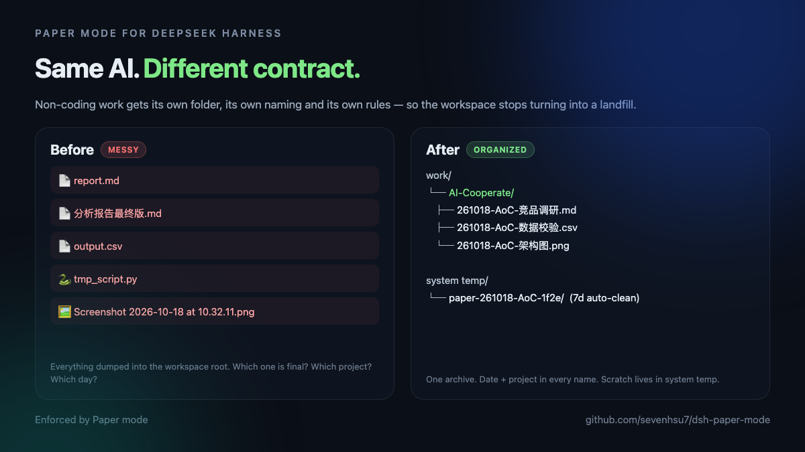
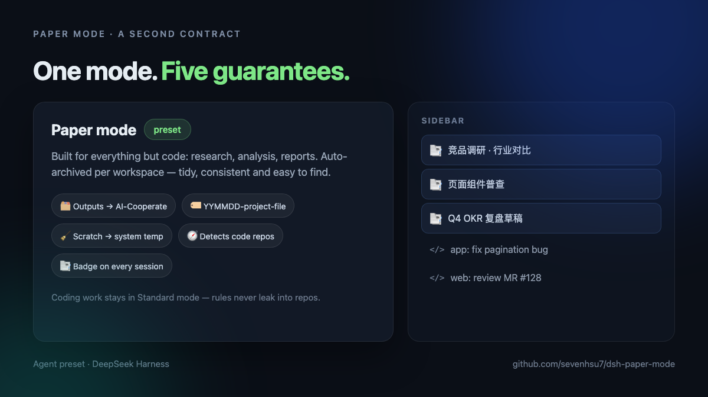
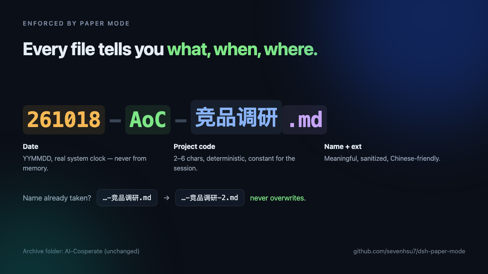

# Paper mode for DeepSeek Harness

**A non-coding work mode for [DeepSeek Harness](https://github.com/deepseek-ai/deepseek-harness) — with enforced artifact governance.**

> Built for everything but code: research, analysis, reports. Auto-archived per workspace — tidy, consistent and easy to find.

Coding agents are great at producing code and bad at delivering everything else: research notes, CSVs, charts, screenshots and one-off scripts end up dumped in the workspace root, named `report.md` or `最终版.md`, while coding and analysis sessions blur together in the sidebar.

Paper mode is an **agent preset** for DSH that gives non-coding work its own contract — and it knows what kind of workspace it is running in:

| Guarantee | What it means |
|---|---|
| 🧭 **Workspace-aware** | Automatically detects whether the workspace is a **git repository** or a **plain folder**. Code repositories get the archive added to their local `.git/info/exclude` and keep scratch out; plain folders just get the archive, with no git handling at all. |
| 🗂 **One archive** | Every output is written to the workspace's `AI-Cooperate/` folder (also recognized: `AI-CoWork/`, `AI-Corporate/`). |
| 🏷 **Enforced naming** | Files are named `YYMMDD-<project-code>-<name>.<ext>`, with the real system date, a project code that stays constant for the session, and `-2`/`-3` de-duplication. Never overwrites. |
| 🧹 **Scratch, not clutter** | Intermediate files (temporary scripts, intermediate data, process screenshots) go to an auto-cleaned system-temp scratch directory via the `scratch` tool — never the workspace — and are deleted after 7 days. |
| 📑 **Identifiable sessions** | A small host plugin prefixes Paper session titles with 📑, so the sidebar shows which sessions are analysis and which are code. |

The naming is not a prompt suggestion: every new file must be written through the bundled **`cowork_save`** tool, which enforces the archive folder, the date/project prefix, sanitizing, de-duplication and never-overwrite at the filesystem boundary.



## Install

Requires a DSH build with the plugin/bundle system (Desktop or `dsh` CLI).

```sh
dsh plugin --profile desktop add github:sevenhsu7/dsh-paper-mode
```

Then restart DeepSeek Harness. A new **"Paper mode"** preset appears in **Settings → Agent presets** and in the new-task picker (custom presets group). The default preset stays **Standard** — Paper mode is selected explicitly, so coding sessions never see its rules.

> Internal ids stay unchanged for compatibility: preset id `cowork`, package `@local/dsh-cowork-preset`, tool `cowork_save`, repo `sevenhsu7/dsh-paper-mode`. Only the display name and the emoji badge changed (💻 → 📑).

<details>
<summary>Alternative: install from a local clone</summary>

```sh
git clone https://github.com/sevenhsu7/dsh-paper-mode.git
dsh plugin --profile desktop add ./dsh-paper-mode
```

Or use Creator mode in the app (`Settings → Agent presets → Creator`) and ask:

> Install the bundle at `/absolute/path/to/dsh-paper-mode` with `plugin_manager` `install_bundle`.

</details>

<details>
<summary>Agent-readable install recipe</summary>

See [`redskill.md`](redskill.md) or the skill at [`skills/install-paper-mode/SKILL.md`](skills/install-paper-mode/SKILL.md). A user can point their agent at that file and say "install this".

</details>

## Use

1. Create a new task and select **Paper mode**.
2. Ask for research, analysis, reports, documents, charts or data work.
3. Files land in `<workspace>/AI-Cooperate/`; if a step needs intermediate files, the agent calls `scratch` and works inside that directory.
4. The session title starts with 📑.



## How it works

This repo is a single DSH bundle (`dsh.bundle.patch` → `cordis.patch.yml`) that contributes four things:

1. **`preset-cowork`** — an `@deepseek-ai/dsh-agent-preset` declaration. It carries the full standard tool set (shell, file read/write/search, web, subagents, todo, plan, compaction, …) plus the Paper mode persona, and intentionally does **not** mount `agent-instructions`, so coding rules from repo `AGENTS.md` files do not leak into analysis sessions.
2. **`cowork-save`** — a preset plugin that registers the `cowork_save` tool. The filesystem contract lives in [`save-core.js`](save-core.js) (pure, unit-testable) and is registered as a hand-built JSON-Schema tool definition in [`save-tool.js`](save-tool.js). That file intentionally imports nothing from `@deepseek-ai/*`: the profile resolves this bundle as a linked package, so a bare specifier would resolve from the bundle's own directory rather than the dsh installation and would fail preset activation.
3. **`paper-scratch`** — a preset plugin ([`scratch-tool.js`](scratch-tool.js), contract in [`scratch-core.js`](scratch-core.js)) that registers the `scratch` tool: creates a per-session directory under `os.tmpdir()` named `paper-YYMMDD-<project-code>-<session>`, plus an optional label subdirectory. A host plugin ([`scratch-cleanup.js`](scratch-cleanup.js)) sweeps that namespace every six hours and deletes directories older than 7 days, skipping live sessions.
4. **`cowork-title-badge`** — a host plugin ([`index.js`](index.js)) that watches `session/title` events and prefixes 📑 on titles of sessions whose preset is `cowork` (internal id). Provider titles are decorated as soon as they land, fallback titles after a grace period, user renames are left alone, and titles are truncated to fit the 80-byte limit.

```
cowork-preset/
├─ package.json          # bundle manifest + plugin exports
├─ cordis.patch.yml      # preset declaration + plugin rows
├─ index.js              # host plugin: 📑 session title badge
├─ save-tool.js          # preset plugin: registers cowork_save (no dsh imports)
├─ save-core.js          # enforced archive/naming logic (pure)
├─ scratch-tool.js       # preset plugin: registers the scratch tool
├─ scratch-core.js       # scratch naming + TTL sweep logic (pure)
├─ scratch-cleanup.js    # host plugin: 7-day scratch cleanup timer
├─ assets/               # README illustrations
└─ skills/               # agent install skill ("redskill")
```

### `cowork_save`

```
cowork_save(filename, content | source_path, project_code?, subdir?)
```

- Resolves the archive folder: `AI-Cooperate/` (the name is unchanged), or an existing `AI-CoWork/`, `AI-Corporate/`, `ai-corporate/`. If several candidates exist it **refuses** and asks the agent to check with the user — it never guesses or merges.
- Stamps the local date (`YYMMDD`) and a project code (given, or derived deterministically from the workspace folder name, e.g. `acme` → `Acm`, `shop-app` → `SA`).
- Sanitizes the file name (spaces/underscores → `-`, forbidden characters removed, date prefixes not duplicated) and appends `-2`, `-3`, … instead of overwriting.
- Copies binary files via `source_path` and supports optional `subdir` grouping.
- **Git-aware**: when the workspace is inside a git repository (including linked worktrees), the archive folder is appended to the repository's local `.git/info/exclude` — idempotently, and never to the tracked `.gitignore`. The tool result reports `gitignored: exclude | already | not-a-repo | failed`.

Example result: `AI-Cooperate/261018-AoC-竞品调研.md`




### `scratch`

```
scratch(project_code?, label?)
```

Creates (and returns) the session's scratch directory under the OS temp directory:

```
$TMPDIR/paper-261018-AoC-1f2e/        # date + project code + short session id
```

- Use it for temporary scripts, intermediate data and process screenshots — **not** for deliverables, and never write scratch into the workspace (including `.tmp/`).
- Optional `label` adds a subdirectory (e.g. `charts`); traversal segments are dropped.
- Directories are created with `0700` permissions, carry a `.paper-scratch.json` ownership record, and are deleted by [`scratch-cleanup.js`](scratch-cleanup.js) once their newest file is older than **7 days** — unless the owning session is still live.
- Copy anything worth keeping into the archive with `cowork_save` before the directory expires.


### Workspace detection

Before saving, `cowork_save` inspects the workspace:

- It walks up from the workspace root to the nearest `.git` — a directory for normal clones, or a file for linked worktrees — so it can tell a **code repository** from a **plain folder**.
- **Code repository** (including worktrees and nested workspaces): the archive is added to the repository's local `.git/info/exclude`, so `git status` stays clean; scratch always lives in system temp, never in the repo.
- **Plain folder**: no git handling at all — no `.gitignore`, no exclude file, just the archive. A directory that merely *contains* repositories (e.g. a `work/` folder) stays a plain folder.

### Git repositories

If the workspace lives in a git repository, the first `cowork_save` also adds the archive folder to the repository's **local** `.git/info/exclude`:

```
# Paper mode archive (local only)
AI-Cooperate/
```

- Only that clone is affected; no tracked file changes and no diff for teammates.
- Works for nested workspaces (page pattern is unanchored) and linked worktrees (the common git dir is used).
- Idempotent: an existing pattern is reported as `already`.
- Already-tracked archive folders are not silently untracked — `git rm -r --cached AI-Cooperate` remains a manual decision.

## Customize

Everything lives in [`cordis.patch.yml`](cordis.patch.yml):

- preset display name / description / order (`name`, `description`, `order`);
- persona rules (archive folder, temp-file policy, boundaries);
- tool set (add or remove rows from the preset `plugins` list).

Note: DSH localizes only built-in presets. Custom preset `name` / `description` are shown verbatim, so pick one language (the repo ships English; a Chinese copy is kept in comments in `cordis.patch.yml`).

This is a prompt-level contract for the agent plus a filesystem-level contract for the save tool; it is not an OS sandbox. Paper mode and Standard mode share one DSH workspace and permission model.

## Compatibility

- DeepSeek Harness Desktop / `dsh` profiles that mount `@deepseek-ai/dsh-web-app` (session titles and agent presets included).
- The title badge requires the session-title service (mounted by the shipped web app); without it, only the 📑 badge is skipped.
- Claude Code / Codex / Cursor do not read this preset; those tools keep their own conventions.

## License

MIT — see [LICENSE](LICENSE).

---

## 中文说明

**Paper mode** 是给 DeepSeek Harness 增加的一个「非编码工作模式」：选中它，AI 只做调研、分析、报告、文档、图表、表格、数据处理这类工作，并遵守一套产物治理规则：

- 产物统一写入工作区的 `AI-Cooperate/`（文件夹名保持不变；已有的 `AI-CoWork/`、`AI-Corporate/` 也会识别）；在 git 仓库里第一次保存会自动写进 `.git/info/exclude`（只影响本机，不动被跟踪的 `.gitignore`），`git status` 保持干净；
- 文件名强制为 `YYMMDD-项目代码-文件名`，日期取系统时间，项目代码整场会话一致，重名自动 `-2`/`-3`，绝不覆盖；
- 过程文件（临时脚本、中间数据、截图）不进工作区：通过 `scratch` 工具放到系统临时目录，7 天后自动清理；
- 自动识别工作区：是 git 仓库就自动写 `.git/info/exclude`、过程文件不进仓库；是普通文件夹就只创建归档目录，不做任何 git 操作；
- 会话标题自动带 📑，侧边栏一眼区分分析会话和编码会话；
- 最关键：**规则只活在模式里**。没选这个模式，规则就不存在——所以编码会话完全不受影响。

安装：

```sh
dsh plugin --profile desktop add github:sevenhsu7/dsh-paper-mode
```

重启 DSH 后，在 设置 → Agent 预设 里会出现「Paper mode」，新建任务时选择即可。默认模式仍是 Standard。

如果想让 AI 帮你装，把 [`redskill.md`](redskill.md) 丢给你的 Agent，说「照这个装」。
